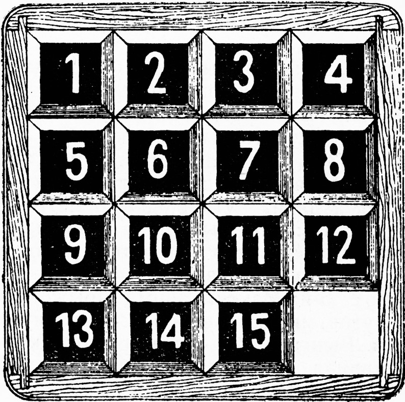

<!-- Page 13 -->

как бы А ни начал, Б первым прыжком может попасть на 11, вторым на 22..., девятым на 99 и, следовательно, должен выиграть.

Вопрос 1-й: длина пути равна 200 футам; остальные условия прежние. А ошибочно расчитал, что для выигрыша он должен, как и прежде, попасть на 1; как должен Б продолжать игру, чтобы выиграть?

Вопрос 2-й: Кто выиграет, если максимальный прыжок для каждого определен в 8 футов, минимальный — в 1 фут, длина пути 90 футов, и как должен поступать выигрывающий?

Вопрос 3-й: Кто выиграет, если максимальный прыжок составляет 17 дециметров, минимальный 1 дециметр, а длина пути равна 15 метрам?

Вопрос 4-й: Кто выиграет, если максимальный прыжок составляет 10 футов, минимальный 3 фута и длина пути равна 182 футам?

Вопрос 5-й: Максимальный прыжок определен в 9 футов, минимальный в 2; длина пути равна 100 футам. Выигравшим считается тот, кто заставит противника достигнуть конца пути (100) или перепрыгнуть через этот конец[^13-1]. Кто из играющих окажется выигравшим?

## Глава II. Игра в пятнадцать.

### § 1. История и описание игры.

В восьмидесятых годах предыдущего столетия в Германии получила широкое распространение

[^13-1]: В этом случае не делается различия между достижением цели и переходом за нее, между тем, как, например, в вопросе 4-м, различие это имеет существенное значение.

<!-- Page 14 -->

„игра в пятнадцать“. На рис. 2 изображен в уменьшенном виде экземпляр этой игры в ящике, в котором находится пятнадцать искусно приготовленных шашек.

*Рис. 2.*

Впервые игра эта появилась в Америке в 1878 г. Говорят, ее остроумный изобретатель был известен в шахматном мире, как выдающийся составитель задач. Сразу же после появления, игра распространилась во всех цивилизованных странах английской культуры, под названием: „Fifteenth Puzzle“ (игры в 15), германской культуры — „Boss Puzzle“ (игры Босса) и у французов, под названием: „Jeu du taquin“ (такен).

В первый же год в нее играли с большим азартом; никакая игра до той поры не пользовалась

<!-- Page 15 -->

подобным успехом. Говорят, в Гамбурге даже у пассажиров дилижансов можно было видеть небольшие ящики с пятнадцатью шашками. Хозяева торговых контор приходили в отчаяние от увлечения служащих этой игрой и принуждены были вывесить аншлаги, с запрещением ее в рабочие часы. Устраивались турниры этой игры и т. п. Даже в зале рейхстага, — как рассказывает Зигмунт Гюнтер, выдающийся географ, математик и либеральный политик, — можно было видеть депутатов, которые, слушая речи, одновременно развлекались этой игрой.

Игра состоит в следующем: пятнадцать квадратных шашек, занумерованных цифрами от 1 до 15, расположены в произвольном порядке в квадратной коробке. 16-е место ящичка остается свободным. Требуется последовательным передвиганием шашек на пустое место с мест смежных, расположить их в порядке, указанном на рис. 2.

Как увидим дальше, во многих случаях невозможно достигнуть указанного, так-называемого „нормального“ расположения шашек; в таких случаях мы будем называть задачу „неразрешимой“. Возможность или невозможность решения зависит исключительно от первоначального расположения шашек. Как же узнать, по расположению шашек, разрешима или неразрешима задача и как, в первом случае, решить ее?

### § 2. Решение задачи.

Прежде чем ответить на эти вопросы, условимся различать „места“ или „клетки“ ящика, обозначая их номерами, соответствующими рис. 2 (от 1 до 16). Например, „место 4“ постоянно обозначает клетку, которую на рис. 2 (т.-е. при нормальном расположении шашек) занимает шашка с нумером 4, а

<!-- Page 16 -->

„место 16“ — нижнюю клетку справа, которая на рис. 2 остается свободной. Далее, горизонтальные ряды клеток будем называть „строками“, а вертикальные — „столбцами“; будем различать первую, вторую, третью и четвертую строки, считая сверху вниз; столбцы также будем именовать: первый, второй, третий, четвертый, — считая слева направо.

Возьмем случайное расположение шашек и попытаемся, посредством передвиганий, получить их нормальное расположение (рис. 2). Будем поступать следующим образом: положим шашку 1 на место 1 (если только она случайно не находится уже там) и затем, не трогая шашки 1, поставим шашку 2 на место 2. Нетрудно убедиться, что этого легко достичь сравнительно небольшим числом ходов. Тогда, не трогая первой строки, можно передвинуть шашки 3 и 4 в клетки 3-го и 4-го столбцов, — если, конечно, шашки эти раньше не находились в них. Во всяком случае, мы должны допустить, что шашки 3 и 4 могут быть, так или иначе, передвинуты на места, находящиеся в последних двух столбцах, и что одновременно в этих столбцах может оказаться и свободное место. Если шашки 3 и 4 случайно не оказались на нужных местах, мы можем привести их туда исключительно путем передвижений внутри восьмиклеточного поля последних двух столбцов. Нет необходимости рассматривать эти ходы для всех возможных случаев, — достаточно остановиться на наиболее неблагоприятном, когда камень 3 находится на месте 4, а камень 4 — на месте 3. Пусть наше восьмиклеточное поле двух последних столбцов имеет расположение, указанное на рис. 3.

При всех ходах шашек, при расположении, указанном на рис. 3, мы не будем трогать 6 и 14 шашек, так как в них нет необходимости; таким образом, мы ограничиваем себя шестью клетками, —
